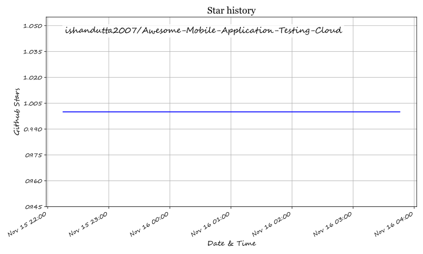

# Awesome Mobile Application Testing Cloud 📱☁️🧪

  
  
  
  
  
  

---

> 🚀 **The definitive curated list of Mobile Application Testing Cloud platforms and Real Device Farms.** Explore leading commercial SaaS device clouds and production-ready open-source infrastructure for running automated and manual tests across real Android, iOS, iPadOS, and Smart TV fleets.
>
> 🌟 *Star this repository to track the mobile cloud testing ecosystem!* 🌟

---

## 📋 Table of Contents

- [🌐 Sector Overview & Market Dynamics](#-sector-overview--market-dynamics)
- [🟦 SaaS / Hosted Platforms](#-saas--hosted-platforms)
- [🟩 Open-Source Software](#-open-source-software)
  - [1. Maestro](#1-maestro-)
  - [2. OpenSTF (Smartphone Test Farm)](#2-openstf-smartphone-test-farm-)
  - [3. Device Farmer STF](#3-device-farmer-stf-)
  - [4. Macaca](#4-macaca-)
  - [5. Sonic](#5-sonic-)
  - [6. Hydra Lab (Microsoft)](#6-hydra-lab-microsoft-)
  - [7. Appium Device Farm](#7-appium-device-farm-)
  - [8. GADS](#8-gads-)
  - [9. DeviceHub](#9-devicehub-)
  - [10. MCloud](#10-mcloud-)
- [📊 Feature Comparison at a Glance](#-feature-comparison-at-a-glance)
- [🤝 Contributing](#-contributing)
- [💖 Support & Sponsorship](#-support--sponsorship)
- [📈 Star History](#-star-history)
- [📄 License](#-license)

---

## 🌐 Sector Overview & Market Dynamics

The global mobile application testing and cloud testing solutions market is valued at approximately **$12.5 billion in 2026** and projected to reach **$38.5 billion by 2032**, expanding at a Compound Annual Growth Rate (CAGR) of ~15.2%. The sector exhibits a **hybrid market structure with high platform infrastructure concentration alongside moderate fragmentation across services and specialized tooling**: hyperscalers and top-tier testing clouds (AWS Device Farm, BrowserStack, Sauce Labs) dominate global device hosting and enterprise execution infrastructure, while innovative startups and active open-source platforms compete vigorously on developer experience, AI-assisted self-healing test automation, and self-hosted private device farm deployments.

---

## 🟦 SaaS / Hosted Platforms

Commercial, cloud-hosted real-device testing infrastructure and automated execution clouds, sorted in descending order by company valuation / parent revenue scale.

| Platform | Company Scale (Revenue / Valuation) | Starting Pricing (Paid Tiers) | Free Tier / Trial Limits | Key Specialization & Device Scope |
|:---|:---|:---|:---|:---|
| **AWS Device Farm** | **$184B+ Annual Run-Rate** *(Amazon Web Services / NASDAQ: AMZN)* | **$0.17 /device minute** *(Pay-As-You-Go metered)* or **$250 /device slot/month** *(Unmetered continuous testing)* | **One-time 1,000 free device minutes** *(no expiration, applies to automated and remote access testing)* | Native AWS cloud integration, managed Appium/Espresso/XCTest execution on 2,500+ physical devices, custom VPC access, and dedicated private device hardware options ($200/mo). |
| **BrowserStack Mobile App Testing** | **$4.0B Valuation** *(~$230M Annual Recurring Revenue)* | **$39 /month** *(App Live manual testing, 1 user, billed annually)* / **$199 /month** *(App Automate, 1 parallel execution slot)* | **Free trial with 30 minutes** of interactive manual App Live testing & **100 minutes** of automated App Automate runs | Industry's largest real device cloud with 30,000+ Android & iOS devices, Day-0 OS/hardware availability, Biometric testing simulation, and camera image injection. |
| **Sauce Labs Mobile** | **~$613M Valuation** *(~$85M Annual Revenue)* | **$39 /month** *(Live testing manual, billed annually)* / **$199 /month** *(Real Device Cloud automated, 1 parallel test)* | **28-day free trial** *(includes 60 automated & live testing minutes, 3 virtual machines in parallel, and 50 AI test authoring queries)* | Deep Real Device Access API exposing raw ADB and xcrun commands via HTTP, MCP-ready for AI agents, 24-hour long-running soak sessions, and IDE plugins. |
| **HeadSpin** | **$28M Acquisition** *(PartnerOne; previously $1.16B peak valuation, ~$21M ARR)* | **$39 /month** *(CloudTest Lite, 1 user, up to 40 hours manual testing/mo)* / **$139 /month** *(CloudTest automated 1 parallel test)* | **Free trial upon sales demo request** *(custom evaluation window, 1 concurrent device allocation)* | Global SIM-card enabled real-device network across 50+ countries, tracking 130+ packet and audio/video performance KPIs, AI regression analysis, and network carrier simulation. |
| **Kobiton** | **Undisclosed / Series B** *(~$40M venture funding raised)* | **$83 /month** *(Startup Plan, includes 500 real device minutes/month, billed annually)* | **30-day free trial** *(100 device testing minutes across public cloud devices, no credit card required)* | Hybrid deployment flexibility (public cloud, private cloud, and on-premises physical device labs), AI scriptless automation generation, self-healing tests, and ADB deep access. |
| **TestGrid** | **Private SME** *(~$5M ARR, high-growth AI testing player)* | **$49 /user/month** *(Starter automated testing)* / **$199 /seat/month** *(CoTester Starter with dedicated real device slots)* | **Free forever plan** *(up to 200 minutes/month testing allowance, community support, no credit card required)* | AI CoTester and AgentRx engine for natural language test creation, self-healing test automation, real-time hardware device vitals (CPU, memory, battery), and Charles Proxy integration. |

---

## 🟩 Open-Source Software

Self-hosted, community-driven Mobile Application Testing Cloud tools and device farms. The open-source ecosystem covers **distributed center-agent cloud testing platforms**, **Appium-compatible device distribution plugins**, **Android and iOS real-device web control farms**, and **declarative end-to-end automation engines**.

Sorted in descending order by GitHub repository star counts:

### 1. Maestro 
- **Repository:** [mobile-dev-inc/Maestro](https://github.com/mobile-dev-inc/Maestro)
- **Tech Stack:** Kotlin ☕ • Java • YAML
- **License:** Apache-2.0
- **Supported Platforms:** Android 🤖 • iOS 🍏 • Web 🌐 • React Native ⚛️ • Flutter 🐦
- **Why It Stands Out:**
  - Fast, declarative mobile UI and end-to-end regression testing framework using human-readable YAML flows instead of complex code.
  - Built-in resilience and smart UI waiting that eliminates flakiness without manual sleep statements.
  - Seamlessly runs on local emulators/simulators, real connected devices, and CI/CD pipelines with zero compilation steps.

### 2. OpenSTF (Smartphone Test Farm) 
- **Repository:** [openstf/stf](https://github.com/openstf/stf)
- **Tech Stack:** Node.js 🟩 • ZeroMQ • RethinkDB 🍃 • AngularJS
- **License:** Apache-2.0
- **Supported Platforms:** Android 🤖
- **Why It Stands Out:**
  - The pioneering open-source web application for controlling, managing, and debugging real Android devices remotely from a browser.
  - Real-time smooth screen streaming via minicap and fast touch interaction via minitouch.
  - Remote ADB debugging access exposing a local port to connect developer workstations directly to remote farm devices.

### 3. Device Farmer STF 
- **Repository:** [DeviceFarmer/stf](https://github.com/DeviceFarmer/stf)
- **Tech Stack:** Node.js 🟩 • TypeScript • RethinkDB • ADB
- **License:** Apache-2.0
- **Supported Platforms:** Android 🤖
- **Why It Stands Out:**
  - The actively maintained community successor and continuation of the original OpenSTF project, supporting modern Android versions (Android 10 through 15+).
  - Web-based shell terminal, real-time logcat streaming, file push/pull manager, and APK drag-and-drop installation.
  - Remote debug panel providing instant `adb connect` endpoints compatible with Chrome DevTools and Android Studio.

### 4. Macaca 
- **Repository:** [alibaba/macaca](https://github.com/alibaba/macaca)
- **Tech Stack:** Node.js 🟩 • Python 🐍 • Java • WebDriver
- **License:** Apache-2.0
- **Supported Platforms:** Android 🤖 • iOS 🍏 • Web 🌐 • Hybrid Apps
- **Why It Stands Out:**
  - Open-source automation solution from Alibaba designed for multi-end mobile and web testing across entire release pipelines.
  - Complete ecosystem featuring UI inspection (Macaca Inspector), device farm orchestration, and cross-language driver SDKs.
  - Lightweight runner architecture supporting continuous regression testing on physical devices and emulators.

### 5. Sonic 
- **Repository:** [SonicCloudOrg/sonic-server](https://github.com/SonicCloudOrg/sonic-server)
- **Tech Stack:** Spring Cloud 🍃 • Vue 3 🖖 • Docker 🐳 • Netty
- **License:** Apache-2.0
- **Supported Platforms:** Android 🤖 • iOS 🍏 • Windows 🪟 • macOS 🍎 • Web 🌐
- **Why It Stands Out:**
  - Comprehensive distributed cloud real-device platform integrating remote control debugging and zero-code automated test execution.
  - Multi-datacenter agent architecture allowing geographically dispersed physical device labs to connect to a unified portal.
  - Built-in network packet capture, audio streaming, WebView debugging via Chrome DevTools, and native Jenkins CI/CD plugins.

### 6. Hydra Lab (Microsoft) 
- **Repository:** [microsoft/hydra-lab](https://github.com/microsoft/hydra-lab)
- **Tech Stack:** Java ☕ • Spring Boot 🍃 • React ⚛️ • Docker 🐳
- **License:** MIT
- **Supported Platforms:** Android 🤖 • iOS 🍏 • Windows 🪟 • Web 🌐
- **Why It Stands Out:**
  - Microsoft-developed framework designed to help enterprise engineering teams build self-hosted cloud testing infrastructure with in-house devices.
  - Multi-framework test execution engine supporting Appium, Espresso, XCTest, Maestro, and Python test suites.
  - Out-of-the-box Docker uber-container providing center-agent distributed management, Monkey exploratory testing, and performance metric charts.

### 7. Appium Device Farm 
- **Repository:** [AppiumTestDistribution/appium-device-farm](https://github.com/AppiumTestDistribution/appium-device-farm)
- **Tech Stack:** TypeScript 🔷 • Appium 2.0 Plugin Architecture
- **License:** Apache-2.0
- **Supported Platforms:** Android 🤖 • iOS 🍏 • Apple TV 📺
- **Why It Stands Out:**
  - Official Appium 2.0 plugin that automatically provisions and allocates sessions across all connected real devices, emulators, and simulators.
  - Eliminates the need for manual device ID filtering and custom routing in test automation suites.
  - Offers a clean web dashboard displaying device availability, active test sessions, live video streaming, and device reservation capabilities.

### 8. GADS 
- **Repository:** [shamanec/GADS](https://github.com/shamanec/GADS)
- **Tech Stack:** Go 🔵 • Appium • WebDriverAgent • WebRTC
- **License:** AGPL-3.0
- **Supported Platforms:** Android 🤖 • iOS 🍏 • Smart TVs (Samsung Tizen, LG WebOS) 📺
- **Why It Stands Out:**
  - Modern self-hosted alternative to AWS Device Farm and Firebase Test Lab with sub-second low-latency WebRTC/MJPEG screen streaming.
  - Native Appium integration, remote touch/swipe/keyboard interactions, clipboard syncing, and remote ADB shell debugging.
  - Unique built-in support for connected Smart TV automation alongside standard Android and iOS mobile devices.

### 9. DeviceHub 
- **Repository:** [VKCOM/devicehub](https://github.com/VKCOM/devicehub)
- **Tech Stack:** Go 🔵 • React ⚛️ • Docker 🐳
- **License:** Apache-2.0
- **Supported Platforms:** Android 🤖 • iOS 🍏
- **Why It Stands Out:**
  - Lightweight browser-based remote device management hub built for engineering teams to share physical smartphones.
  - Low-latency real-time video streaming, interactive multi-touch controls, and APK drag-and-drop deployment.
  - Integrated reverse port forwarding and remote debugging proxy capabilities for local developer tooling.

### 10. MCloud 
- **Repository:** [zebrunner/mcloud](https://github.com/zebrunner/mcloud)
- **Tech Stack:** Docker 🐳 • Ansible • Python 🐍 • Appium
- **License:** Apache-2.0
- **Supported Platforms:** Android 🤖 • iOS 🍏 • Smart TVs 📺
- **Why It Stands Out:**
  - Enterprise-grade mobile farm ecosystem orchestrating fleets of physical devices and simulators using Docker Compose and Ansible.
  - Combines automated Appium test routing with human-interactive web-based remote control sessions.
  - Native integration with the Zebrunner Continuous Testing platform for rich test execution analytics and failure reporting.

---

## 📊 Feature Comparison at a Glance

| Platform / Tool | Model & License | Target Platforms | Real Device Fleet | Remote Control & Web UI | Self-Hosted / On-Prem | Automated Frameworks Supported | Ideal Use Case |
|:---|:---|:---|:---:|:---:|:---:|:---|:---|
| **AWS Device Farm** | Commercial SaaS | Android, iOS, Web | ✅ 2,500+ | ✅ | ⚠️ *(Private Lab)* | Appium, Espresso, XCTest, Python | Teams standardized on AWS wanting pay-per-minute flexibility |
| **BrowserStack** | Commercial SaaS | Android, iOS, Web | ✅ 30,000+ | ✅ | ❌ | Appium, Espresso, XCUITest, Flutter, Detox | Teams needing the widest device coverage and Day-0 device access |
| **Sauce Labs** | Commercial SaaS | Android, iOS, Web | ✅ Extensive | ✅ *(RDA API)* | ⚠️ *(Private Cloud)* | Appium, Espresso, XCUITest, Raw ADB | AI-driven testing workflows & long-running soak test sessions |
| **HeadSpin** | Commercial SaaS | Android, iOS, Web | ✅ Global SIMs | ✅ | ⚠️ *(On-prem appliance)* | Appium, Selenium, XCUITest | Validating real-world cellular carrier and audio/video performance |
| **Kobiton** | Commercial SaaS | Android, iOS | ✅ | ✅ | ✅ *(On-Premises)* | Appium, Espresso, XCUITest, Scriptless AI | Hybrid deployments combining in-house labs with cloud capacity |
| **TestGrid** | Freemium SaaS | Android, iOS, Web | ✅ | ✅ | ✅ *(Hybrid/Local)* | Appium, Robot, Selenium, CoTester AI | Teams wanting AI-assisted test generation and deep device vitals |
| **Maestro** | Open Source (Apache-2.0) | Android, iOS, Web | ✅ | ❌ *(Automation)* | ✅ | Maestro YAML | Fast, resilient declarative UI test automation without flakiness |
| **OpenSTF** | Open Source (Apache-2.0) | Android | ✅ *(Your devices)* | ✅ | ✅ | ADB, Chrome DevTools | Distributing Android test devices across distributed engineering teams |
| **Device Farmer STF**| Open Source (Apache-2.0) | Android (10-15+) | ✅ *(Your devices)* | ✅ | ✅ | ADB Remote, Chrome DevTools | Actively maintained Android device farm for distributed QA teams |
| **Macaca** | Open Source (Apache-2.0) | Android, iOS, Web | ✅ *(Your devices)* | ✅ | ✅ | WebDriver, Macaca SDKs | Cross-platform multi-end enterprise testing pipelines |
| **Sonic** | Open Source (Apache-2.0) | Android, iOS, Web | ✅ *(Your devices)* | ✅ | ✅ | Sonic Zero-Code, Appium | Multi-datacenter cloud real-device platform with zero-code automation |
| **Hydra Lab** | Open Source (MIT) | Android, iOS, Win | ✅ *(Your devices)* | ✅ | ✅ | Appium, Espresso, XCTest, Maestro | Building a Microsoft-backed enterprise private device cloud |
| **Appium Device Farm**| Open Source (Apache-2.0) | Android, iOS, tvOS | ✅ *(Your devices)* | ✅ | ✅ | Appium 2.0 | Automatic device allocation and session management for Appium grids |
| **GADS** | Open Source (AGPL-3.0) | Android, iOS, TV | ✅ *(Your devices)* | ✅ *(WebRTC)* | ✅ | Appium, Selenium Grid 4 | Self-hosted AWS Device Farm alternative with Smart TV support |
| **DeviceHub** | Open Source (Apache-2.0) | Android, iOS | ✅ *(Your devices)* | ✅ | ✅ | Reverse Port Forwarding | Lightweight real smartphone sharing hub with interactive web controls |
| **MCloud** | Open Source (Apache-2.0) | Android, iOS, TV | ✅ *(Your devices)* | ✅ | ✅ | Appium, Zebrunner | Scalable containerized device fleet orchestration using Docker & Ansible |

---

## 🤝 Contributing

Contributions are warmly welcome! If you maintain or use a mobile cloud testing platform, real device farm manager, or mobile automation infrastructure tool that fits this list:

1. Fork this repository.
2. Create a new branch: `git checkout -b feature/AddToolName`.
3. Add your tool to the appropriate section in alphabetical or sorted order with:
   - Tool name and link
   - Tech stack and open-source license (or SaaS tier details)
   - Why it stands out (2–3 bullet points)
4. Commit your changes: `git commit -m "Add ToolName to Mobile Cloud Testing list"`.
5. Push to your branch and open a Pull Request.

Please make sure open-source tools are actively maintained and adhere to open-source licensing standards.

---

## 💖 Support & Sponsorship

If this curated repository saved you research time or assisted in choosing the right Mobile Testing Cloud / Device Farm solution for your team, please consider supporting the project:

- ⭐ **Star this repository** to help other developers and QA engineers discover it.
- 🍴 **Fork and contribute** your own insights or tools.
- 📢 **Share with fellow mobile developers, QA leads, and SDETs.**
- ☕ **Buy me a coffee / Sponsor:** Support ongoing maintenance via the [GitHub Sponsors Dashboard](https://github.com/sponsors/ishandutta2007).

---

## 📈 Star History

<a href="https://star-history.com/#ishandutta2007/Awesome-Mobile-Application-Testing-Cloud&Timeline" align="center">
  <picture>
    <source media="(prefers-color-scheme: dark)" srcset="assets/ishandutta2007_Awesome-Mobile-Application-Testing-Cloud_growth.svg">
    
  </picture>
</a>

---

## 📄 License

This repository and curated list are released under the [Creative Commons Zero v1.0 Universal](https://creativecommons.org/publicdomain/zero/1.0/) (CC0 1.0 - Public Domain Dedication). All referenced software, trademarks, and brand names belong to their respective copyright holders.
